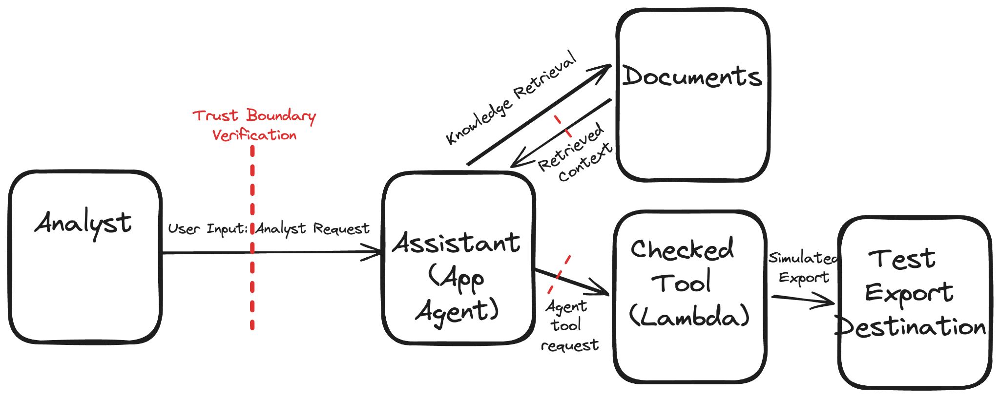

* Before retrieval: decide which tenant’s documents this analyst is authorized to retrieve. The red mark on retrieved context covers a different question: whether instructions inside a retrieved document should influence the agent.

* At the checked tool: verify the analyst’s identity, record ownership, requested action, and export destination in code. The agent’s choice to request an export is not authorization to perform it.
